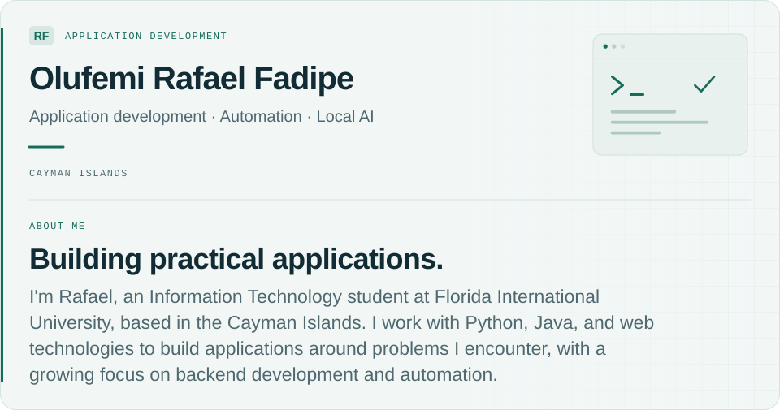

<picture>
  <source media="(prefers-color-scheme: dark)" srcset="assets/profile-dark.svg">
  
</picture>

# Building practical applications.

I'm Rafael, an Information Technology student at **Florida International University**, based in the **Cayman Islands**. I work with Python, Java, and web technologies to build applications around problems I encounter, with a growing focus on backend development and automation.

## What I'm building

### Job Application Bot

Searching for development roles showed me how much time goes into finding relevant opportunities and checking their requirements. I started building a Python application to make that process easier to manage.

- **Discover:** Retrieve listings from configured Greenhouse and Lever employer feeds.
- **Compare:** Rank roles against a skills profile, with location and eligibility notes for review.
- **Track:** Store jobs and application status in SQLite, and export CSV and JSON shortlists.
- **Test:** Check matching, persistence, and tracking with automated tests; explore form preparation through a local Playwright practice demo.

**Built with:** `Python` `REST APIs` `SQLite` `Playwright` `pytest`  
**Status:** Working CLI application, under active development. Source code is currently private.

## Selected work

| Project | What I built | Technologies |
| :--- | :--- | :--- |
| **[Verdant Clay](https://github.com/olufemifadipe/verdant-clay-website)** | A jewelry website prototype with collection filters, product detail dialogs, and WhatsApp enquiries. | HTML · CSS · JavaScript |
| **[Air Quality Explorer](https://github.com/olufemifadipe/aqi_project)** | A Python application that retrieves IQAir air quality and weather data, processes JSON responses, and generates a Folium map. | Python · REST APIs · Folium |
| **[Musical Instruments](https://github.com/olufemifadipe/Musical-Instruments-Strategy-Pattern)** | An object-oriented implementation of the Strategy Pattern, separating instruments from interchangeable playing behaviors. | Python · OOP · Design patterns |

## Tools I work with

**Languages** — Python · Java · SQL · HTML · CSS · JavaScript  
**Data & automation** — SQLite · MySQL · REST APIs · JSON · Playwright  
**Development** — Git · GitHub · Linux · VS Code · pytest

## Nova & my home lab

I'm also building **Nova**, a local AI assistant, and running a home lab with dedicated machines for AI workloads, development, and Linux practice. It gives me a place to work with Ollama, SSH, and private networking while learning how to deploy and troubleshoot applications across machines.

## Opportunities & collaboration

I'm open to **software development internships, junior developer roles, and project collaborations**, especially in backend development, automation, and web applications.

[Explore my repositories →](https://github.com/olufemifadipe?tab=repositories)
