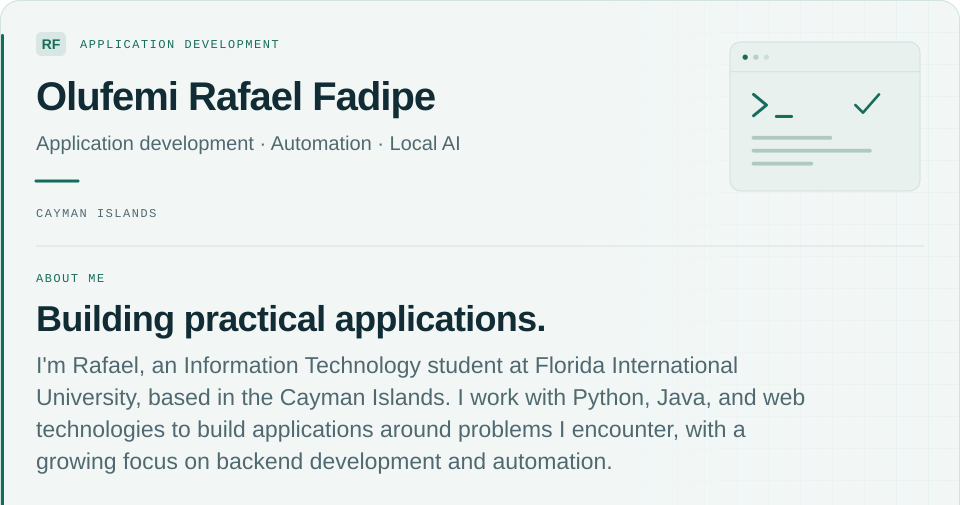
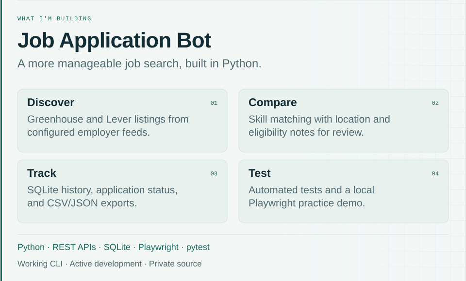
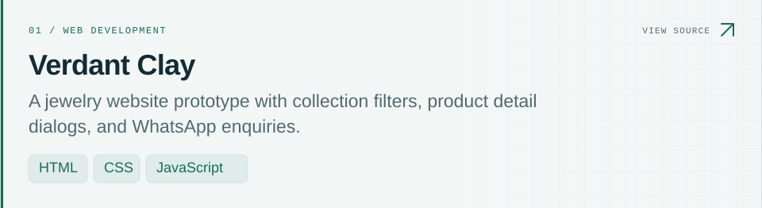
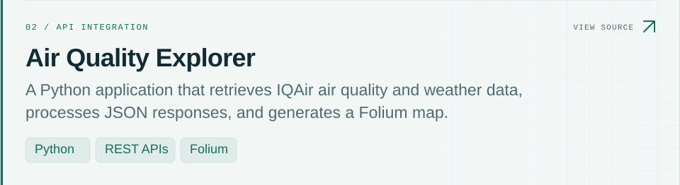
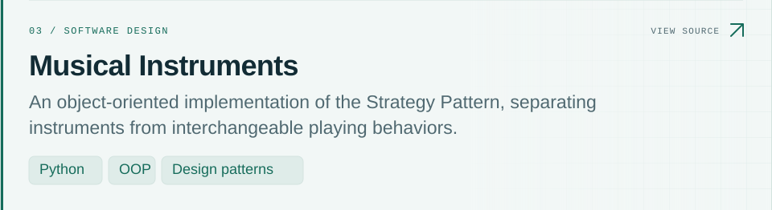
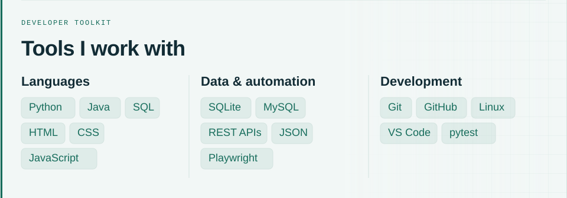
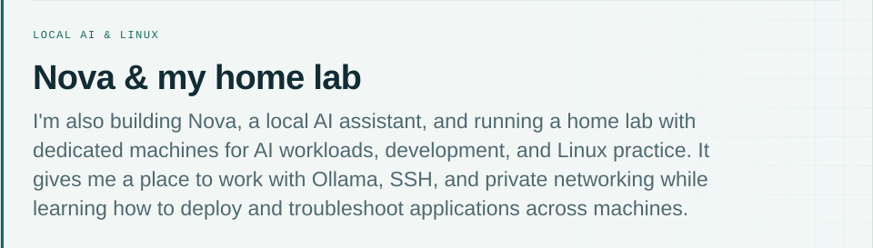
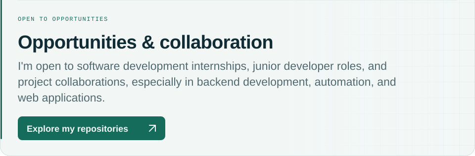

<picture>
  <source media="(prefers-color-scheme: dark) and (max-width: 900px)" srcset="assets/panel/profile-dark-mobile.svg">
  <source media="(prefers-color-scheme: dark)" srcset="assets/panel/profile-dark.svg">
  <source media="(max-width: 900px)" srcset="assets/panel/profile-light-mobile.svg">
  
</picture>
<picture>
  <source media="(prefers-color-scheme: dark) and (max-width: 900px)" srcset="assets/panel/jobbot-dark-mobile.svg">
  <source media="(prefers-color-scheme: dark)" srcset="assets/panel/jobbot-dark.svg">
  <source media="(max-width: 900px)" srcset="assets/panel/jobbot-light-mobile.svg">
  
</picture>
<picture>
  <source media="(prefers-color-scheme: dark) and (max-width: 900px)" srcset="assets/panel/selected-work-dark-mobile.svg">
  <source media="(prefers-color-scheme: dark)" srcset="assets/panel/selected-work-dark.svg">
  <source media="(max-width: 900px)" srcset="assets/panel/selected-work-light-mobile.svg">
  
</picture>
<a href="https://github.com/olufemifadipe/verdant-clay-website">
<picture>
  <source media="(prefers-color-scheme: dark) and (max-width: 900px)" srcset="assets/panel/verdant-clay-dark-mobile.svg">
  <source media="(prefers-color-scheme: dark)" srcset="assets/panel/verdant-clay-dark.svg">
  <source media="(max-width: 900px)" srcset="assets/panel/verdant-clay-light-mobile.svg">
  
</picture>
</a>
<a href="https://github.com/olufemifadipe/aqi_project">
<picture>
  <source media="(prefers-color-scheme: dark) and (max-width: 900px)" srcset="assets/panel/air-quality-dark-mobile.svg">
  <source media="(prefers-color-scheme: dark)" srcset="assets/panel/air-quality-dark.svg">
  <source media="(max-width: 900px)" srcset="assets/panel/air-quality-light-mobile.svg">
  
</picture>
</a>
<a href="https://github.com/olufemifadipe/Musical-Instruments-Strategy-Pattern">
<picture>
  <source media="(prefers-color-scheme: dark) and (max-width: 900px)" srcset="assets/panel/musical-instruments-dark-mobile.svg">
  <source media="(prefers-color-scheme: dark)" srcset="assets/panel/musical-instruments-dark.svg">
  <source media="(max-width: 900px)" srcset="assets/panel/musical-instruments-light-mobile.svg">
  
</picture>
</a>
<picture>
  <source media="(prefers-color-scheme: dark) and (max-width: 900px)" srcset="assets/panel/tools-dark-mobile.svg">
  <source media="(prefers-color-scheme: dark)" srcset="assets/panel/tools-dark.svg">
  <source media="(max-width: 900px)" srcset="assets/panel/tools-light-mobile.svg">
  
</picture>
<picture>
  <source media="(prefers-color-scheme: dark) and (max-width: 900px)" srcset="assets/panel/nova-dark-mobile.svg">
  <source media="(prefers-color-scheme: dark)" srcset="assets/panel/nova-dark.svg">
  <source media="(max-width: 900px)" srcset="assets/panel/nova-light-mobile.svg">
  
</picture>
<a href="https://github.com/olufemifadipe?tab=repositories">
<picture>
  <source media="(prefers-color-scheme: dark) and (max-width: 900px)" srcset="assets/panel/opportunities-dark-mobile.svg">
  <source media="(prefers-color-scheme: dark)" srcset="assets/panel/opportunities-dark.svg">
  <source media="(max-width: 900px)" srcset="assets/panel/opportunities-light-mobile.svg">
  
</picture>
</a>
 

