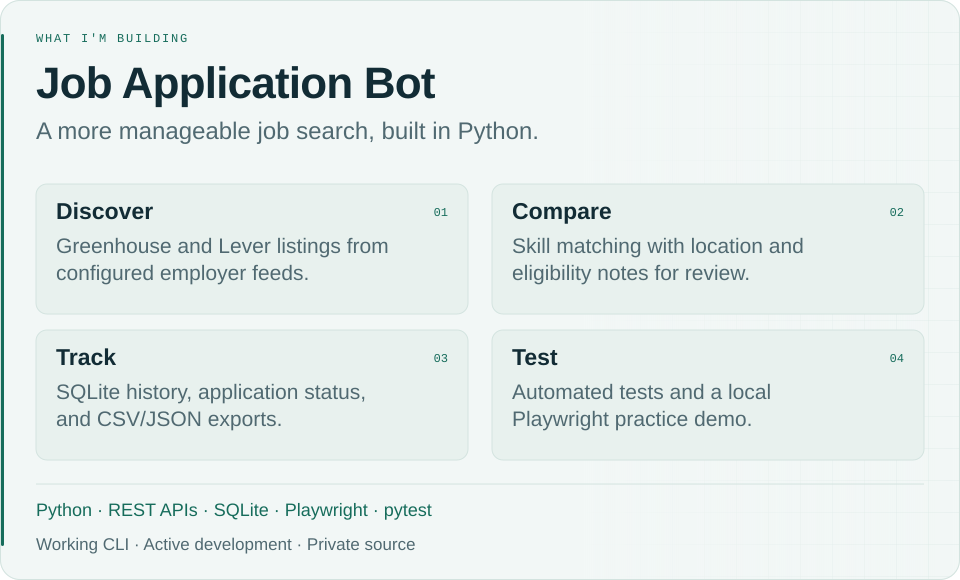
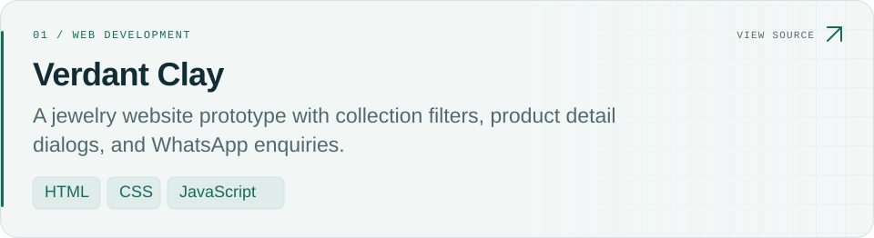
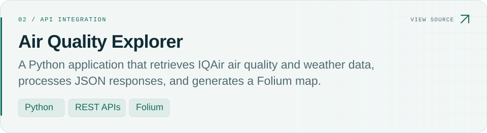
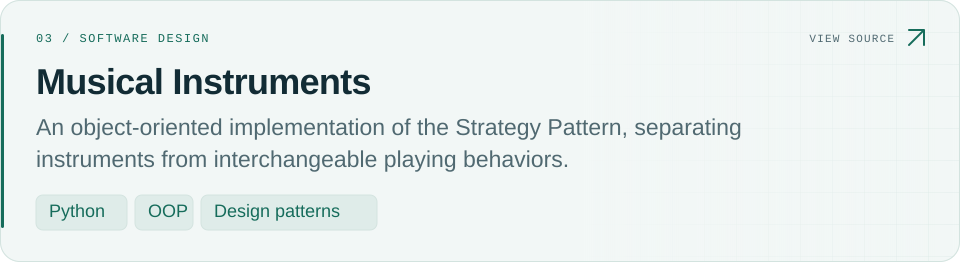
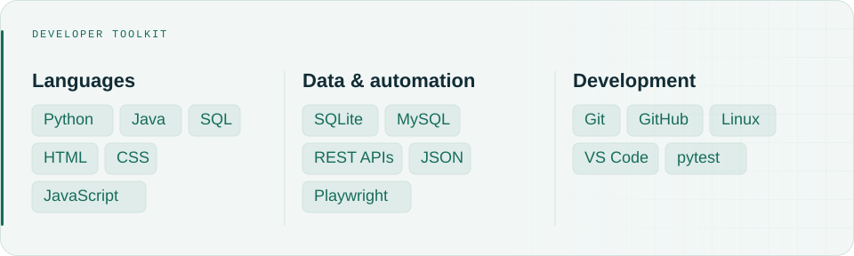
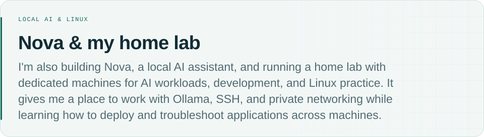
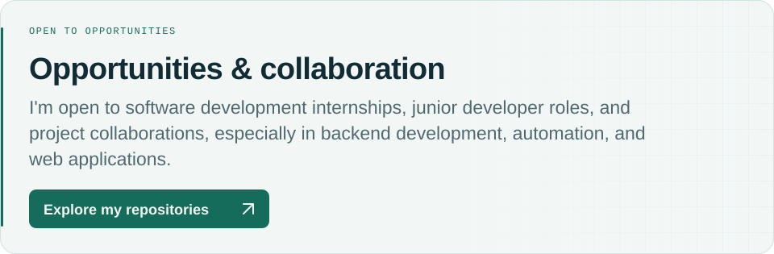

<picture>
  <source media="(prefers-color-scheme: dark) and (max-width: 900px)" srcset="assets/profile-dark-mobile.svg">
  <source media="(prefers-color-scheme: dark)" srcset="assets/profile-dark.svg">
  <source media="(max-width: 900px)" srcset="assets/profile-light-mobile.svg">
  
</picture>

<picture>
  <source media="(prefers-color-scheme: dark) and (max-width: 900px)" srcset="assets/cards/jobbot-dark-mobile.svg">
  <source media="(prefers-color-scheme: dark)" srcset="assets/cards/jobbot-dark.svg">
  <source media="(max-width: 900px)" srcset="assets/cards/jobbot-light-mobile.svg">
  
</picture>

Read the job bot details

### Job Application Bot

Searching for development roles showed me how much time goes into finding relevant opportunities and checking their requirements. I started building a Python application to make that process easier to manage.

- **Discover:** Retrieve listings from configured Greenhouse and Lever employer feeds.
- **Compare:** Rank roles against a skills profile, with location and eligibility notes for review.
- **Track:** Store jobs and application status in SQLite, and export CSV and JSON shortlists.
- **Test:** Check matching, persistence, and tracking with automated tests; explore form preparation through a local Playwright practice demo.

**Built with:** `Python` `REST APIs` `SQLite` `Playwright` `pytest`  
**Status:** Working CLI application, under active development. Source code is currently private.

## Selected work

<a href="https://github.com/olufemifadipe/verdant-clay-website">
<picture>
  <source media="(prefers-color-scheme: dark) and (max-width: 900px)" srcset="assets/cards/verdant-clay-dark-mobile.svg">
  <source media="(prefers-color-scheme: dark)" srcset="assets/cards/verdant-clay-dark.svg">
  <source media="(max-width: 900px)" srcset="assets/cards/verdant-clay-light-mobile.svg">
  
</picture>
</a>

<a href="https://github.com/olufemifadipe/aqi_project">
<picture>
  <source media="(prefers-color-scheme: dark) and (max-width: 900px)" srcset="assets/cards/air-quality-dark-mobile.svg">
  <source media="(prefers-color-scheme: dark)" srcset="assets/cards/air-quality-dark.svg">
  <source media="(max-width: 900px)" srcset="assets/cards/air-quality-light-mobile.svg">
  
</picture>
</a>

<a href="https://github.com/olufemifadipe/Musical-Instruments-Strategy-Pattern">
<picture>
  <source media="(prefers-color-scheme: dark) and (max-width: 900px)" srcset="assets/cards/musical-instruments-dark-mobile.svg">
  <source media="(prefers-color-scheme: dark)" srcset="assets/cards/musical-instruments-dark.svg">
  <source media="(max-width: 900px)" srcset="assets/cards/musical-instruments-light-mobile.svg">
  
</picture>
</a>

## Tools I work with

<picture>
  <source media="(prefers-color-scheme: dark) and (max-width: 900px)" srcset="assets/cards/tools-dark-mobile.svg">
  <source media="(prefers-color-scheme: dark)" srcset="assets/cards/tools-dark.svg">
  <source media="(max-width: 900px)" srcset="assets/cards/tools-light-mobile.svg">
  
</picture>

<picture>
  <source media="(prefers-color-scheme: dark) and (max-width: 900px)" srcset="assets/cards/nova-dark-mobile.svg">
  <source media="(prefers-color-scheme: dark)" srcset="assets/cards/nova-dark.svg">
  <source media="(max-width: 900px)" srcset="assets/cards/nova-light-mobile.svg">
  
</picture>

Read about Nova and my home lab

## Nova & my home lab

I'm also building **Nova**, a local AI assistant, and running a home lab with dedicated machines for AI workloads, development, and Linux practice. It gives me a place to work with Ollama, SSH, and private networking while learning how to deploy and troubleshoot applications across machines.

<a href="https://github.com/olufemifadipe?tab=repositories">
<picture>
  <source media="(prefers-color-scheme: dark) and (max-width: 900px)" srcset="assets/cards/opportunities-dark-mobile.svg">
  <source media="(prefers-color-scheme: dark)" srcset="assets/cards/opportunities-dark.svg">
  <source media="(max-width: 900px)" srcset="assets/cards/opportunities-light-mobile.svg">
  
</picture>
</a>

Read opportunities and collaboration details

## Opportunities & collaboration

I'm open to **software development internships, junior developer roles, and project collaborations**, especially in backend development, automation, and web applications.

[Explore my repositories →](https://github.com/olufemifadipe?tab=repositories)

